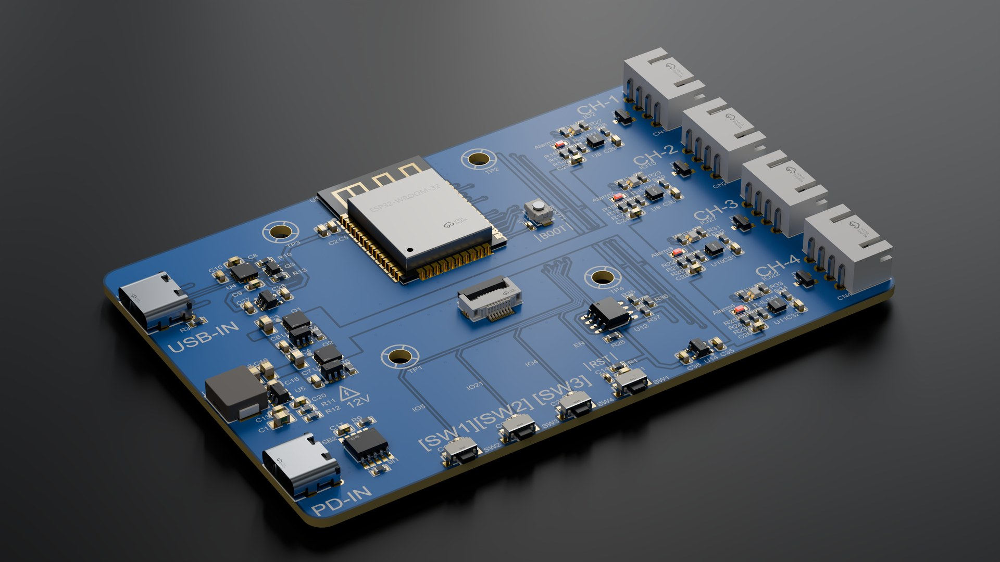
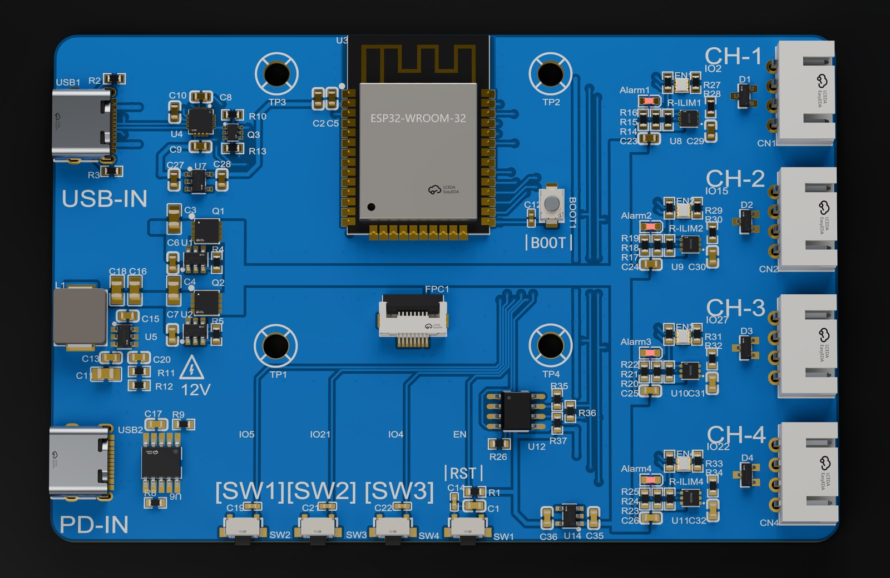
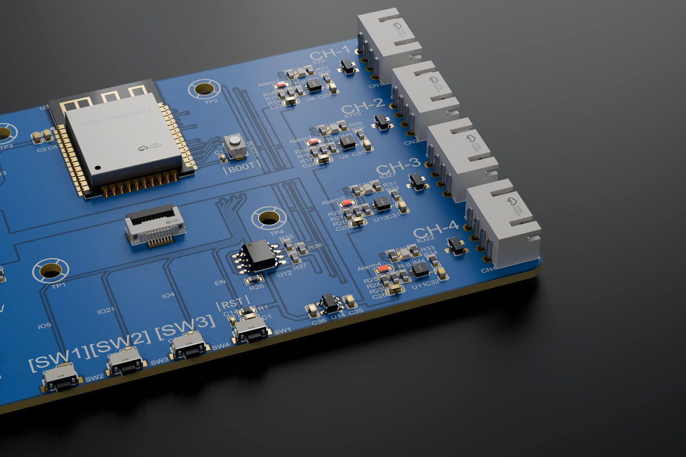
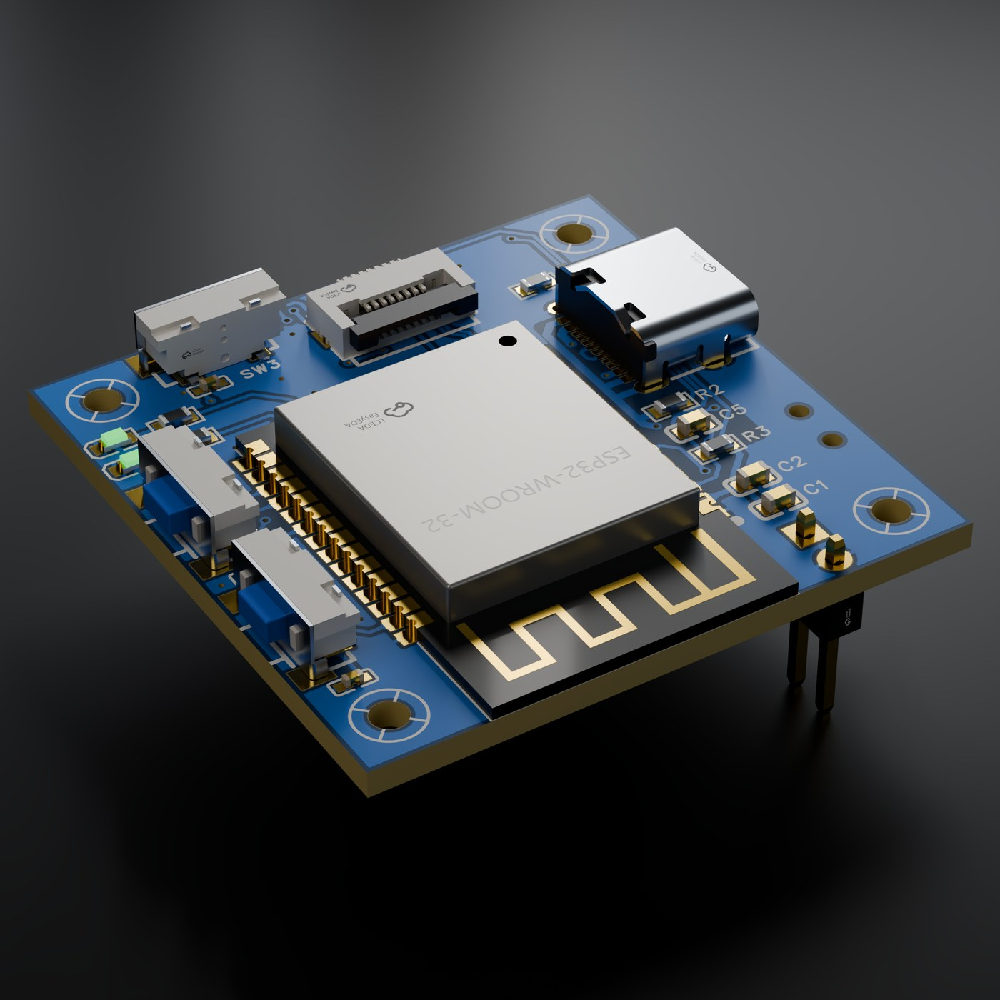

# PCB-Render-Kit

Turn a PCB drawn in **LCEDA / JLCEDA (EasyEDA) Pro** into a photo-realistic 3D rendering.

> **You need**: a finished board + Blender + Python.
> **You get**: 2K/4K product shots — a 3/4 hero, a top view and a macro — with per-component colours, blue solder mask, gold pads, white silkscreen and visible copper traces.

**Language**: [中文](README.md) · English

The whole workflow is two steps:

```
1. Click "Render Kit" in the EDA PCB editor -> you get a .zip
2. Run one command -> you get the renders
```

## Gallery

| 3/4 hero (4K) | Top view |
|---|---|
|  |  |

| Macro detail (pads / silkscreen / traces) | Small square board |
|---|---|
|  |  |

Every component gets its own physical material (gold pins, plain MLCC bodies, black IC epoxy, white plastic connectors, shield cans), so colour separation comes from the STEP geometry itself instead of a flat texture.

The repository contains two things:

| Path | What it is | Required? |
|---|---|---|
| [`skill/pcb-render/`](skill/pcb-render/) | The render skill: turns the zip into images | Yes |
| [`eda-extension/`](eda-extension/) | LCEDA extension: one-click export of the render kit zip | Optional (you can export STEP + DXF by hand) |

---

## 1. Install the environment

| Software | Version | Notes |
|---|---|---|
| **Blender** | 4.2+ (5.x recommended) | the render engine, you never need to open it |
| **Python** | 3.10+ | runs the render scripts |
| LCEDA Pro | 3.2+ | optional, used to export the kit |

Install the Python dependencies (once):

```bash
python -m pip install -r skill/pcb-render/requirements.txt
```

**You do not need to configure Blender's path.** The scripts look for it automatically: PATH, `C:\Program Files\Blender Foundation\`, Steam libraries, `/Applications`, `/usr/bin`, snap and flatpak are all checked.

Check what was found:

```bash
python skill/pcb-render/scripts/env.py
```

If `blender` has a path in the output, you are good. Otherwise, pick one:

```bash
# A. per command
python skill/pcb-render/scripts/pipeline.py --blender "C:/Program Files/Blender Foundation/Blender 5.2/blender.exe" ...

# B. once and for all: copy config.example.json to config.json and set "blender"
#    (also accepts %APPDATA%/pcb-render/config.json or ~/.config/pcb-render/config.json,
#     or the PCB_RENDER_BLENDER environment variable)
```

---

## 2. Install the skill (so the AI can use it)

The skill is a standard **Agent Skills** directory — drop it where your tool looks for skills.

**DeepSeek Harness (DSH)**

```powershell
# Windows: directory junction (recommended — edits in this repo take effect immediately)
cmd /c mklink /J "%USERPROFILE%\.dsh\skills\pcb-render" "<this repo>\skill\pcb-render"

# or just copy
Copy-Item -Recurse -Force .\skill\pcb-render "$env:USERPROFILE\.dsh\skills\pcb-render"
```

```bash
# macOS / Linux
cp -r skill/pcb-render ~/.dsh/skills/pcb-render
```

**Claude Code / Codex / others**

```bash
cp -r skill/pcb-render ~/.claude/skills/pcb-render     # or your tool's skills directory
```

**No install needed**: call the script directly (next section), or tell your agent to use `skill/pcb-render/scripts/pipeline.py`.

Once installed, just ask:

> Use pcb-render to render `D:\board\PCB1_render-kit.zip` at 2K.

---

## 3. Install the EDA extension (optional but recommended)

1. Open **LCEDA Pro** and open your PCB
2. Top menu: `Advanced` → `Extension Manager...` → `Import`
3. Pick `pcb-render-kit_v1.0.0.eext`:
   - no clone needed: download the [**release asset**](https://github.com/maker114/PCB-Render-Kit/releases/download/v1.0.0/pcb-render-kit_v1.0.0.eext)
   - already cloned: use [`dist/pcb-render-kit_v1.0.0.eext`](dist/pcb-render-kit_v1.0.0.eext)
4. Make sure it is **enabled** (restart EDA if necessary)
5. Open the PCB editor — the menu **"Render Kit"** should appear

> The first third-party extension triggers an "unknown source" warning — that is expected for an unsigned local extension.

Menu items:

| Item | Exports |
|---|---|
| **Export everything (as ZIP)** | all files packed into one zip, one save dialog ← **use this** |
| STEP 3D only | `PCB1_3D.step` (assembly, with 3D component models) |
| DXF only | `PCB1_DXF.dxf` (silkscreen / mask / copper / outline) |
| Gerber / BOM / Pick&Place / netlist | one file each |

---

## 4. Usage

### Step 1 — export the kit

PCB editor → **"Render Kit"** → **"Export everything (as ZIP)"** → save anywhere.

(Without the extension, prepare a zip containing at least `*_3D.step` and `*_DXF.dxf`.)

### Step 2 — render

```bash
# quick composition check first (~1 minute, 800 px)
python skill/pcb-render/scripts/pipeline.py \
    --package "D:/board/PCB1_render-kit.zip" \
    --workdir "D:/board/render-out" \
    --resolution preview

# then the real thing (2K ~2-3 min, 4K longer)
python skill/pcb-render/scripts/pipeline.py \
    --package "D:/board/PCB1_render-kit.zip" \
    --workdir "D:/board/render-out" \
    --resolution 2k
```

Useful options:

| Option | Meaning |
|---|---|
| `--resolution preview / 2k / 4k` | output size (**start with preview**) |
| `--views hero,top,macro` | render only some views, e.g. `--views hero` |
| `--samples 200` | samples — cleaner but slower |
| `--blender <path>` | override Blender |
| `--skip-render` | build the scene only, no render |
| `--macro-target X,Y` `--macro-distance 0.06` | macro aim point and camera distance (metres) |

### Step 3 — collect the images

Output lands in `<workdir>/render/out/final/`:

| File | Content |
|---|---|
| `01_hero.png` | 3/4 hero shot |
| `02_top.png` | top view |
| `03_macro.png` | macro close-up |
| `*_16bit.png` | 16-bit masters (for post-processing) |
| `*.jpg` | same-size JPEG, ready to share |

**Check the result at 100 %** in three places: a pad, a trace and a silkscreen label. Thumbnails hide problems.

---

## 5. Troubleshooting

| Symptom | Fix |
|---|---|
| "missing Python dependency" | run the `pip install -r ...requirements.txt` command printed in the error |
| `Blender not found` | use `--blender`, or write the path into `config.json` (section 1) |
| No traces / the board is plain blue | the STEP export did not include the copper products — re-export with the extension |
| Silkscreen text is shifted | same cause: silkscreen must come from STEP, not be redrawn from DXF |
| The "macro" is still the whole board | add `--distance 0.05-0.07` |
| Rendering is very slow | never run two renders at once; on a laptop, plug in the charger |

More background, including why these things happen, is in
[`skill/pcb-render/references/pitfalls.md`](skill/pcb-render/references/pitfalls.md) and the
troubleshooting table in [`SKILL.md`](skill/pcb-render/SKILL.md).

---

## 6. Layout

```
PCB-Render-Kit/
├─ skill/pcb-render/          the render skill
│  ├─ SKILL.md                what the AI reads
│  ├─ requirements.txt        Python dependencies
│  ├─ config.example.json     Blender path and other overrides
│  ├─ scripts/                11 pipeline scripts + env.py (auto-detection)
│  └─ references/             step-by-step commands, pitfalls, material & camera notes
├─ eda-extension/
│  ├─ pcb-render-kit/         extension source (TypeScript)
│  ├─ sdk/  demo/             official SDK reference clones (untracked, not needed to build)
│  └─ README.md               extension development notes
├─ dist/                      built .eext, ready to import
└─ scripts/                   install-skill.ps1 / build-eext.ps1
```

Rebuild the extension:

```powershell
powershell -File scripts\build-eext.ps1
```

---

## 7. License

Code in this repository is **MIT** — see [LICENSE](LICENSE).
`eda-extension/pcb-render-kit/` is derived from the official EasyEDA extension template and stays
**Apache-2.0** — see the `LICENSE` in that directory.
