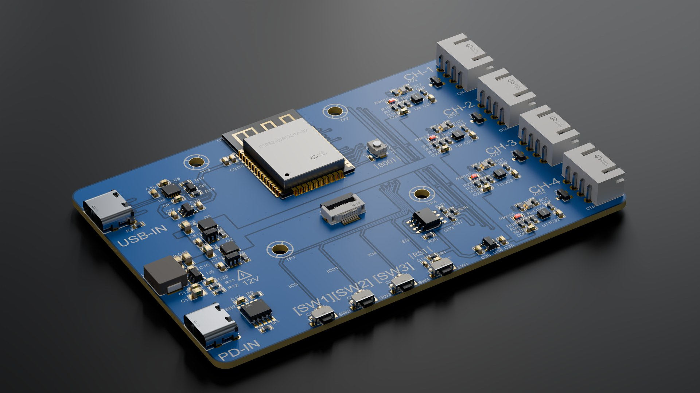
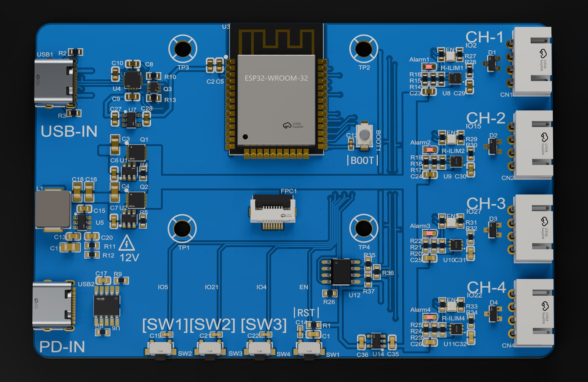
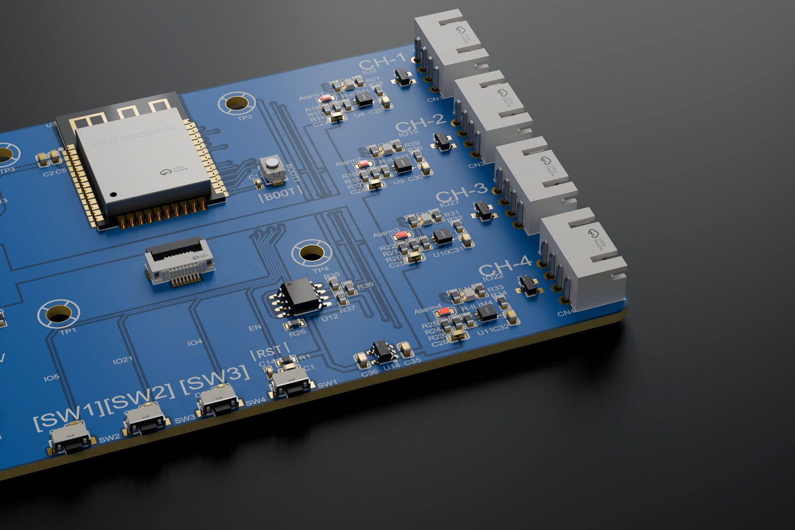
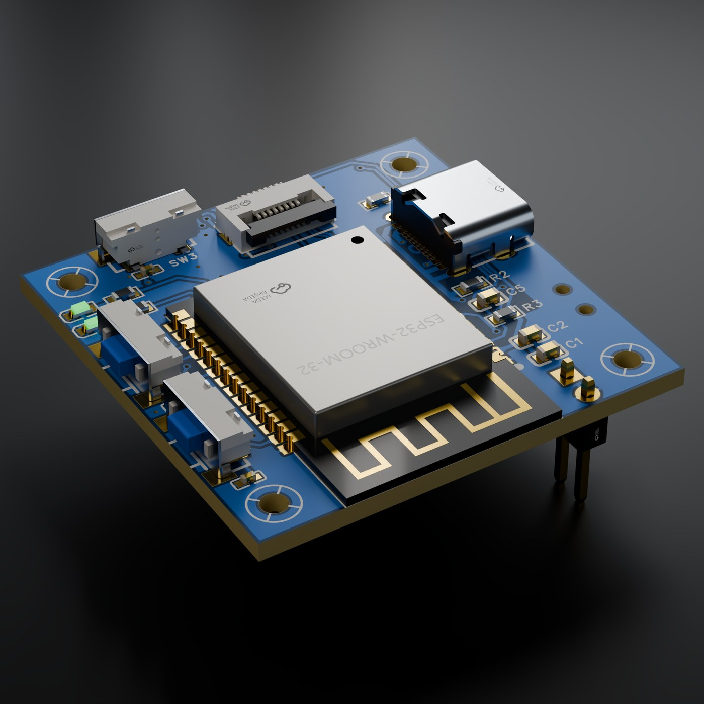

# PCB-Render-Kit

把 **立创EDA / 嘉立创EDA（专业版）** 画的 PCB，渲染成照片级 3D 效果图。

[](LICENSE)
[](https://github.com/maker114/PCB-Render-Kit/releases)
[](https://www.blender.org/)
[](https://www.python.org/)

> **需要什么**：一块画完的板子 + Blender + Python。
> **得到什么**：2K/4K 的板子效果图（3/4 主图、俯视图、微距特写），每个元件独立分色，蓝色阻焊、金色焊盘、白色丝印和铜箔走线都还原。

整个流程只有两步：

```
① 在 EDA 里点一下「渲染素材包」，导出一个 zip
② 跑一条命令，得到效果图
```

**语言**：中文 · [English](README.en.md)

## 效果图

| 3/4 主图（4K） | 俯视图 |
|---|---|
|  |  |

| 微距细节（焊盘 / 丝印 / 走线） | 小尺寸方板 |
|---|---|
|  |  |

每个元件都是独立的物理材质（镀金引脚、MLCC 陶瓷本体、IC 黑色环氧、白色塑料壳、屏蔽罩），
所以"分色"来自 STEP 几何本身，而不是一张平涂贴图。

仓库包含两部分：

| 目录 | 作用 | 必需吗 |
|---|---|---|
| [`skill/pcb-render/`](skill/pcb-render/) | 渲染技能：把 zip 变成效果图 | 必需 |
| [`eda-extension/`](eda-extension/) | 立创EDA 扩展：一键导出素材包 zip | 可选（也可以手动导出 STEP + DXF） |

---

## 1. 先装环境

| 软件 | 版本 | 说明 |
|---|---|---|
| **Blender** | 4.2 以上（推荐 5.x） | 渲染引擎，装好后不用打开 |
| **Python** | 3.10 以上 | 跑渲染脚本 |
| 立创EDA 专业版 | 3.2 以上 | 可选，用来导出素材包 |

装 Python 依赖（只需一次）：

```bash
python -m pip install -r skill/pcb-render/requirements.txt
```

> 国内网络慢可以加镜像：`-i https://pypi.tuna.tsinghua.edu.cn/simple`

**Blender 不用配环境变量**：脚本会自动找（PATH、`C:\Program Files\Blender Foundation\`、Steam 库、`/Applications`、`/usr/bin` 等）。
找不到时手动指定，二选一：

```bash
# 方式 A：命令行直接给
python skill/pcb-render/scripts/pipeline.py --blender "C:/Program Files/Blender Foundation/Blender 5.2/blender.exe" ...

# 方式 B：写进配置文件（一次配好，永久生效）
# 把 skill/pcb-render/config.example.json 复制成 config.json，填上 blender 路径
```

先看看能不能找到：

```bash
python skill/pcb-render/scripts/env.py
```

输出里 `blender` 有路径就说明可以用了。

---

## 2. 装渲染技能（让 AI 自己会用）

技能是标准 **Agent Skills** 目录，放进 AI 工具扫描的位置即可。选一个：

**DeepSeek Harness（DSH）**

```powershell
# Windows：目录联接（推荐，改仓库立即生效）
cmd /c mklink /J "%USERPROFILE%\.dsh\skills\pcb-render" "<本仓库路径>\skill\pcb-render"

# 或者直接复制
Copy-Item -Recurse -Force .\skill\pcb-render "$env:USERPROFILE\.dsh\skills\pcb-render"
```

```bash
# macOS / Linux
cp -r skill/pcb-render ~/.dsh/skills/pcb-render
```

**Claude Code / Codex 等**

```bash
cp -r skill/pcb-render ~/.claude/skills/pcb-render     # 或对应工具的技能目录
```

**不想装也行**：直接跑命令（见下一节），或者告诉 AI「用 `skill/pcb-render/scripts/pipeline.py` 渲染这个 zip」。

装好之后，直接对 AI 说：

> 用 pcb-render 把这个包渲成 2K：`D:\board\PCB1_渲染素材包.zip`

它就会自己跑完整条流程。

---

## 3. 装 EDA 扩展（可选，推荐）

有了它，导出素材包只要点一下；没有它也可以手动导出 STEP 和 DXF。

1. 打开 **立创EDA（专业版）** → 打开你的 PCB
2. 顶部菜单：`高级` → `扩展管理器...` → `导入`
3. 选 `pcb-render-kit_v1.0.0.eext` —— 两种拿法：
   - 不想克隆仓库：直接下载 [**Releases 附件**](https://github.com/maker114/PCB-Render-Kit/releases/download/v1.0.0/pcb-render-kit_v1.0.0.eext)
   - 已经克隆：用仓库里的 [`dist/pcb-render-kit_v1.0.0.eext`](dist/pcb-render-kit_v1.0.0.eext)
4. 确认扩展是**启用**状态（必要时重启 EDA）
5. 打开 PCB 编辑器，顶部菜单出现 **「渲染素材包」** 就成功了

> 第一次装第三方扩展，EDA 会提示「未知来源」，这是正常的（本地扩展没签名）。

菜单项：

| 菜单项 | 导出内容 |
|---|---|
| **一键导出全部（打包为 ZIP）** | 全部文件打成一个 zip，只弹一次保存框 ← **用这个** |
| 仅导出 STEP 3D 模型 | `PCB1_3D.step`（含元件 3D 模型） |
| 仅导出 DXF 图形层 | `PCB1_DXF.dxf`（丝印/阻焊/铜层/板框） |
| 仅导出 Gerber / BOM / 贴片坐标 / 网表 | 各自单独一个文件 |

---

## 4. 用起来

### 第 1 步：导出素材包

PCB 编辑器 → 顶部菜单 **「渲染素材包」** → **「一键导出全部（打包为 ZIP）」** → 存到任意位置。

（不用扩展的话，需要自己准备一个 zip，里面至少有 `*_3D.step` 和 `*_DXF.dxf`。）

### 第 2 步：渲染

```bash
# 先出快图看构图（约 1 分钟，800px）
python skill/pcb-render/scripts/pipeline.py \
    --package "D:/board/PCB1_渲染素材包.zip" \
    --workdir "D:/board/render-out" \
    --resolution preview

# 满意后出正式图（2K 约 2~3 分钟，4K 更久）
python skill/pcb-render/scripts/pipeline.py \
    --package "D:/board/PCB1_渲染素材包.zip" \
    --workdir "D:/board/render-out" \
    --resolution 2k
```

常用参数：

| 参数 | 作用 |
|---|---|
| `--resolution preview / 2k / 4k` | 分辨率档位（**先用 preview 试构图**） |
| `--views hero,top,macro` | 只出部分图，例如 `--views hero` |
| `--samples 200` | 采样数，越高越干净也越慢 |
| `--blender <路径>` | 手动指定 Blender |
| `--skip-render` | 只建场景不渲染（改材质后用） |
| `--macro-target X,Y` `--macro-distance 0.06` | 微距瞄准点和机位距离（单位：米） |

### 第 3 步：拿图

结果在 `<workdir>/render/out/final/`：

| 文件 | 内容 |
|---|---|
| `01_hero.png` | 3/4 主图（首图） |
| `02_top.png` | 俯视图 |
| `03_macro.png` | 微距特写 |
| `*_16bit.png` | 16 位母版（后期用） |
| `*.jpg` | 同尺寸 JPEG，方便直接发 |

**出图后请按 100% 放大抽查 3 处**：焊盘、走线、丝印文字。缩略图看不出问题。

---

## 5. 出问题了

| 症状 | 解决 |
|---|---|
| 提示缺少 Python 依赖 | 按报错里给的命令 `pip install -r ...requirements.txt` |
| 提示 Blender not found | `--blender "路径"`，或写进 `config.json`（见第 1 节） |
| 走线看不见 / 板子一片纯蓝 | 素材包里的 STEP 没带铜层产品，重新用扩展「一键导出全部」 |
| 丝印文字错位 | 同上，导出时确保勾选/包含 STEP 3D（丝印从 STEP 取，不用 DXF 重绘） |
| 微距还是整板 | 加 `--distance 0.05~0.07` |
| 渲染特别慢 | 不要同时跑两个渲染任务；笔记本拔电池、插电源 |

更多问题与原因分析见 [`skill/pcb-render/references/pitfalls.md`](skill/pcb-render/references/pitfalls.md)
和 [`SKILL.md`](skill/pcb-render/SKILL.md) 里的故障对照表。

---

## 6. 目录结构

```
PCB-Render-Kit/
├─ skill/pcb-render/          渲染技能
│  ├─ SKILL.md                技能说明（AI 读这个）
│  ├─ requirements.txt        Python 依赖
│  ├─ config.example.json     Blender 路径等覆盖配置
│  ├─ scripts/                11 个脚本 + env.py（自动探测环境）
│  └─ references/             分步命令、踩坑记录、材质与构图参数
├─ eda-extension/
│  ├─ pcb-render-kit/         扩展源码（TypeScript）
│  ├─ sdk/  demo/             官方 SDK 参考克隆（不跟踪，构建不需要）
│  └─ README.md               扩展的开发笔记
├─ dist/                      构建好的 .eext，可直接导入
└─ scripts/                   install-skill.ps1 / build-eext.ps1
```

想改扩展？见 [`eda-extension/README.md`](eda-extension/README.md)，重新构建：

```powershell
powershell -File scripts\build-eext.ps1
```

---

## 7. 许可

本仓库自有代码采用 **MIT**（见 [LICENSE](LICENSE)）。
`eda-extension/pcb-render-kit/` 由立创EDA 官方扩展模板派生，沿用模板的 **Apache-2.0**（见该目录下 `LICENSE`）。
